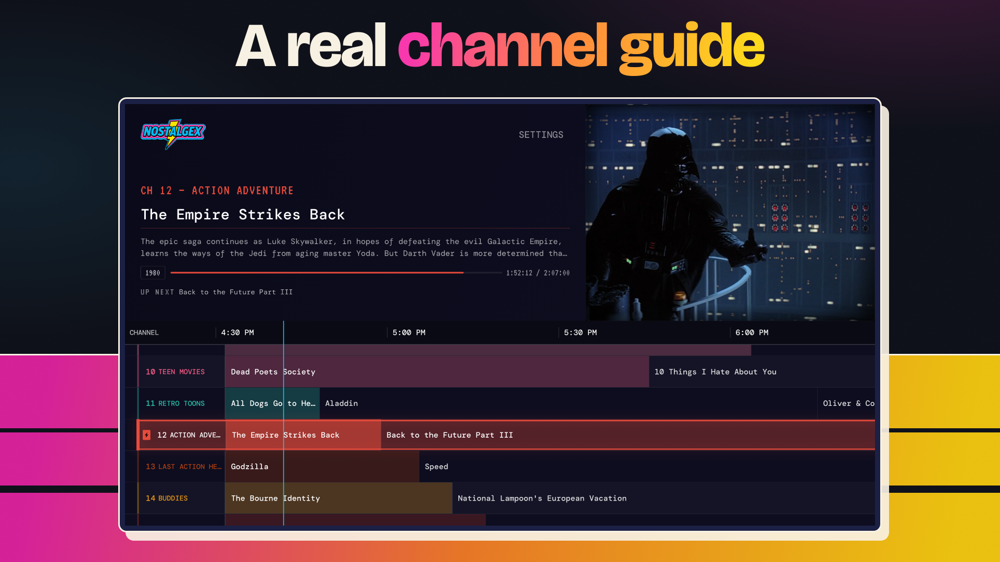

# Nostalgex

**Retro TV for your own movie and show library.** Free and open source, for Plex, Jellyfin and Emby.

[](LICENSE)
[](https://discord.gg/FgnZcr5bDT)
[](https://apps.apple.com/app/id6762563534)
[](https://www.nostalgex.app/web-tuner)
[](https://github.com/chadMueller/Nostalgex/pkgs/container/nostalgex)



Nostalgex turns your library into 130+ channels in 14 bundles, plus a channel for every film series you own, with a real channel guide. Every channel plays on a set daily schedule, so tuning in feels like live TV. No account to make, and it never supplies any media of its own.

<a id="get-it"></a>
<a id="works-with"></a>
## Pick your way to watch

| | Apple TV app | Web tuner | Docker container |
|---|---|---|---|
| **What it is** | An app for your TV and Siri Remote | Nostalgex in your browser | The web tuner, running on a computer at home |
| **Best for** | Watching on a TV | Trying it right now, on a laptop or phone | Jellyfin or Emby setups the web tuner can't reach |
| **Works with** | Plex, Jellyfin, Emby | Plex, Jellyfin, Emby | Plex, Jellyfin, Emby |
| **Get it** | <a href="https://apps.apple.com/app/id6762563534"></a> | <a href="https://www.nostalgex.app/web-tuner"></a><br>[Open the web tuner](https://www.nostalgex.app/web-tuner) | <a href="https://www.nostalgex.app/self-host"></a><br>[Docker container guide](https://www.nostalgex.app/self-host) |

All three are free. Not sure? Use the app on a TV and the web tuner everywhere else.

<a id="tvos-nostalgex"></a>
<a id="apple-tv-app"></a>
## <a href="https://apps.apple.com/app/id6762563534"></a> Apple TV app

The best way to watch on a TV. Connect one or more servers, then flip channels with the Siri Remote. Needs tvOS 18 or later.

**Quick start:** install [Nostalgex from the App Store](https://apps.apple.com/app/id6762563534), connect your server, pick a channel.

<a id="web-tuner-web-tunerhtml--plex-tunerhtml"></a>
<a id="web-tuner"></a>
## <a href="https://www.nostalgex.app/web-tuner"></a> Web tuner

Nothing to install. Works on computers and phones.

**Quick start:** open [nostalgex.app/web-tuner](https://www.nostalgex.app/web-tuner) and sign in to your server. Plex just works. Jellyfin and Emby need a secure (https) address; if yours doesn't have one, use the Docker container instead.

<a id="run-it-on-your-server"></a>
<a id="docker-container"></a>
##  Docker container

The same web tuner, packaged as a Docker container that runs on a computer at home, so it can reach servers the website can't. Most Plex users don't need it.

**Quick start:**

```sh
docker run -d --name nostalgex -p 8080:8080 --restart unless-stopped ghcr.io/chadmueller/nostalgex:latest
```

Then open `http://YOUR-SERVER-IP:8080`. Step by step help is in the [Docker container guide](https://www.nostalgex.app/self-host).

**Latest: `tuner-v1.0.11`.** Every package now has its own block of channel numbers with room to grow (KIDZ ZONE starts at 30, collections at 400, HIGH ROTATION at 500), and Norwegian, Bokmal and Nynorsk count as one language when picking audio and subtitles. [Release notes](https://github.com/chadMueller/Nostalgex/releases/tag/tuner-v1.0.11). Already running it? `docker compose pull && docker compose up -d`.

<a id="whats-new-in-1028"></a>
## What's new in 1.0.28

1.0.27 is folded in, so this is everything since 1.0.26. [Full release notes](https://github.com/chadMueller/Nostalgex/releases/tag/v1.0.28)

- **An easier Jellyfin and Emby sign-in.** Pick Jellyfin or Emby and Nostalgex finds your server on your network. Jellyfin puts a Quick Connect code on screen to approve from your phone, Emby shows its users so you pick your name, and the address is checked before you type a password.
- **Holiday channels.** TIS THE SEASON grows to eight channels with MISTLETOE, CHRISTMAS SPECIALS, KIDS CHRISTMAS TV and TURKEY DAY, and shows up a week before US Thanksgiving.
- **SCREAM is eight channels** and can stay on in any month, plus MYSTERY BOX TV, CRINGE TV and A24.
- **Ratings from outside the US** count like their US equivalents, so UK, German and other ratings fill the kids and family channels.
- **Clock changes** no longer leave channels dark for the last hour of the day.
- **Playback:** Blu-ray 7.1 audio plays, Emby keeps the sound in sync when you join a film part way through, Jellyfin and Emby stop burning subtitles into the picture, and stalled streams recover.
- **TV show collections** become channels too, and Report Playback is two switches. Thanks to [@w6trp](https://github.com/w6trp) and [@tydude001](https://github.com/tydude001).

## Join in

- Website: [nostalgex.app](https://www.nostalgex.app)
- Apple TV app: [App Store](https://apps.apple.com/app/id6762563534)
- Chat: [Discord](https://discord.gg/FgnZcr5bDT)
- Ideas and questions: [GitHub Discussions](https://github.com/chadMueller/Nostalgex/discussions)
- Instagram: [@nostalgex_](https://www.instagram.com/nostalgex_/)
- Updates by email: [sign up](https://www.nostalgex.app/#signup)
- Enjoying it? [Buy me a coffee](https://buymeacoffee.com/chadmueller)

<a id="support-the-project"></a>
## Tips and supporting the project

Nostalgex is free. If it gives you a good Friday night, you can [buy me a coffee](https://buymeacoffee.com/chadmueller) or leave a tip in the Apple TV app (Settings has Popcorn, TV Dinner and Pizza Night). Tips are a thank you. They cover the Apple developer fee and keep updates coming. The Sponsor button at the top of this repo goes to Buy Me a Coffee.

Helping costs nothing too: star the repo, rate the app on the App Store, or tell me about a channel that's always empty.

---

## More details

<details>
<summary><strong>Privacy: what leaves your network</strong></summary>

<a id="what-leaves-your-network"></a>
**Apple TV app:**

- **Your media server.** Direct from the Apple TV to your Plex, Jellyfin or Emby. Sign-in goes straight to the server, and Show Now Playing and Mark Watched only talk to that same server. No credentials are ever sent anywhere else.
- **plex.tv** (Plex only). The PIN sign-in flow and server discovery, like every Plex client.
- **iCloud** (only if you turn on sync). Your lineup and settings, in your own iCloud. Server logins stay on the device.
- **MusicBrainz.** Public metadata for the music video channels. No key, no account.
- **TMDB, via nostalgex.app.** When Supabase values are present, the TMDB ids of titles in your library go to the site's proxy (`api/tmdb.js`, in this repo), which forwards them to TMDB with the site's key, keeps no log, and caches the answer at the edge. OMDb only if you build with a key. Off in your own build unless you add the Supabase values.
- **Supabase.** The shared enrichment cache, keyed on TMDB id. Same condition as above.
- **TelemetryDeck.** Anonymous usage signals in the App Store build. No identifiers, no library contents, no server addresses. Off in your own build unless you keep the key.

The website and web tuner at nostalgex.app load one page analytics script (statsngraphs). The Docker container has its own list in the Docker container extras below. The privacy policy at `/privacy` covers all of this in plain language.

</details>

<details>
<summary><strong>Docker container extras: Compose, updates, devices and limits</strong></summary>

The image is nginx serving static files on port 8080, no database, nothing to sign up for. Because it's plain http on your own network, it can reach a plain `http://` Jellyfin or Emby server, which the https site can't. You probably don't need it if you use Plex, or if your Jellyfin or Emby is already on https with a valid certificate.

Port 8080 already taken? Use `-p 8099:8080` and open port 8099 instead.

<a id="quick-start"></a>
**Compose** (fuller version in [`docker/compose.yaml`](docker/compose.yaml), which also sets `no-new-privileges`), then `docker compose up -d`:

```yaml
services:
  nostalgex:
    image: ghcr.io/chadmueller/nostalgex:latest
    container_name: nostalgex
    ports:
      - "8080:8080"
    environment:
      NOSTALGEX_ENRICHMENT: "on"   # "off" for no outside requests, see below
    read_only: true
    tmpfs:
      - /tmp
    restart: unless-stopped
```

**Update:** `docker compose pull && docker compose up -d`, or `docker pull ghcr.io/chadmueller/nostalgex:latest` and recreate the container. Image tags are `latest`, `1.0` and `1.0.0`; each release adds its own version tag. Releases are tagged `tuner-v*`. The bottom of Settings says which one you're running, e.g. `WEB TUNER 1.0.11 · DOCKER`.

**Platforms:** amd64 and arm64 (Synology and Unraid on Intel or AMD, NUCs, Raspberry Pi 4 and 5 on a 64 bit OS). No armv7. Runs as a non root user (uid 101) and works with a read only root filesystem as long as `/tmp` is writable.

**Where it's been tested:** Chrome, Safari and Firefox on a Mac, iPhone and iPad Safari, and the TV Bro browser on Google TV. Fire TV Silk, Samsung and LG browsers are untested. Roku has no browser. On Apple TV, use the app. The current table is in the [Docker container guide](https://www.nostalgex.app/self-host).

<a id="what-the-containers-tuner-talks-to"></a>
**What the Docker container talks to:**

| Where | When | Turn it off |
|---|---|---|
| Your media server | Always. Sign-in and playback go straight from the browser to your server. | |
| plex.tv | Plex only: PIN sign-in and finding your server, like every Plex app. | Use Jellyfin or Emby |
| The shared metadata cache (Supabase) and the nostalgex.app TMDB/OMDb relay | On by default. Nine or more channels need keywords, studios or IMDb ratings to fill (TEEN MOVIES, TRUE CRIME, CULT CLASSICS and others). Only TMDB and IMDb ids leave the browser: no titles, no server address, no credentials. | `NOSTALGEX_ENRICHMENT=off` |

No analytics, no scripts or fonts from a CDN, and no MusicBrainz or Deezer lookups in the image. A value the container doesn't recognize is treated as `off`.

<a id="known-limits"></a>
**Known limits:**

- **A reverse proxy puts the wall back.** If the tuner is behind https and Jellyfin is plain http, the browser blocks Jellyfin again. Serve both the same way.
- **Surround audio on TV browsers.** Some can't decode 5.1. Try a laptop or phone first, and use the Apple TV app on a TV.
- **Music video genres** from MusicBrainz and Deezer are off. Titles and artists still show.

<a id="build-the-image-yourself"></a>
**Build the image yourself:**

```sh
docker build -t nostalgex .
docker run -d --name nostalgex -p 8080:8080 nostalgex
```

Enrichment needs the shared cache's address and public anon key at build time: add `--build-arg VITE_SUPABASE_URL=... --build-arg VITE_SUPABASE_ANON_KEY=...`, or point them at your own Supabase project. Without them it builds with enrichment off. To skip Docker, `npm run build:selfhost` writes the same files to `dist-selfhost/`; any static server works if it serves `.cjs` as JavaScript.

Reporting a container problem? Include your server and its version, the machine running Docker, the browser, the output of `docker logs nostalgex`, and anything red in the browser console.

</details>

<details>
<summary><strong>Why the web tuner can't reach some servers</strong></summary>

The hosted tuner is served over HTTPS, so browsers block mixed content and it cannot reach a server on plain `http://` or on a raw LAN IP. Plex works because plex.direct issues real certificates for local addresses. Jellyfin and Emby need an HTTPS URL with a valid certificate (reverse proxy or tunnel). A local only server with no HTTPS is reachable from the Apple TV app but not from the hosted site, unless you use the [Docker container](#run-it-on-your-server), where it is plain http too.

</details>

<details>
<summary><strong>How channels and schedules work</strong></summary>

<a id="apps"></a>
<a id="shared-config"></a>
<a id="channelsjson"></a>
Both apps read the same channel configuration, `channels.json` (130+ channels in 14 bundles). The Apple TV app ships its own copy, so a channel change reaches it with an app update. The web tuner reads the site's copy on every load, and the Docker image carries the copy it was built with. Franchise and collection channels are built on top of that from your own library. See `CHANNELS.md` for a readable breakdown of each channel.

<a id="schedule-logic"></a>
Both apps use a daily seeded shuffle. Each channel's pool is shuffled once per day (seeded by date + channel ID), then looped end to end. Your spot in the loop comes from the clock, so tuning in at 2:15 PM always lands at the same place that day. On tvOS, when a video ends the next one starts from the beginning; on first tune in you join mid stream like real TV.

**The two schedules have diverged.** tvOS adds premiere priority, sequel adjacency, prime time premieres for new additions, and a 6 hour refresh. The web tuner has none of those, so the same server on the same day will not show the same lineup in both places.

</details>

<details>
<summary><strong>Channel rules</strong></summary>

<a id="channel-rules"></a>
Channels filter your library (Plex, Jellyfin or Emby, normalized to one internal model) using combinations of:

- **type**: movie or episode
- **genres**: include, exclude, requireAll
- **studios**: Disney, HBO, etc.
- **yearRange**: min/max year
- **contentRatings**: whitelist (TV-Y, PG, R, etc.)
- **durationRange**: min/max minutes
- **watchedOnly / unwatchedOnly / rewatched**: watch history filters
- **timeRestrictions**: block mature content before a set hour

</details>

<details>
<summary><strong>Franchise channels</strong></summary>

Each film series in your library (Star Wars, Rocky, whatever you own) gets its own channel and its own switch in Settings. Server collections land in FRANCHISES or OTHER COLLECTIONS. NOTABLE STARS is retired. There's no fixed list: it depends on your library.

</details>

<details>
<summary><strong>Help, support and other devices</strong></summary>

<a id="community-and-support"></a>
<a id="other-platforms"></a>
- **Bugs and feature requests:** [GitHub Issues](https://github.com/chadMueller/Nostalgex/issues). Include your server (Plex, Jellyfin or Emby), its version, and your Apple TV model.
- **Email:** support@nostalgex.app
- **Help pages:** [support](https://www.nostalgex.app/support), [Docker container guide](https://www.nostalgex.app/self-host) and [docs/FAQ.md](docs/FAQ.md).

**Other devices:** a Roku port by [tydude001](https://github.com/tydude001) is in the works ([discussion #8](https://github.com/chadMueller/Nostalgex/discussions/8)); it installs by sideloading for now. A Fire TV fork by [WSINTRA](https://github.com/WSINTRA) exists; it's unofficial and I don't support it. For a supported option on a TV today, use the Apple TV app, or the Docker container in a TV browser.

</details>

<details>
<summary><strong>Who maintains it and how often it updates</strong></summary>

<a id="maintained"></a>
Nostalgex has been on the App Store since April 19, 2026, and gets updates every month. I'm one person, and I read every issue.

- **Releases:** 1.0.28 is live on the App Store. History is in [GitHub releases](https://github.com/chadMueller/Nostalgex/releases), the [App Store version history](https://apps.apple.com/app/id6762563534) and [`content/changelog.json`](content/changelog.json).
- **Dev log:** [docs/DEVLOG.md](docs/DEVLOG.md) explains why things changed and what's still half done.
- **Outside contributors:** thank you to [@w6trp](https://github.com/w6trp) for #18, #19, #20 and #21 in 1.0.26, and to [@Gorbataras](https://github.com/Gorbataras) for [#5](https://github.com/chadMueller/Nostalgex/pull/5) and [#7](https://github.com/chadMueller/Nostalgex/pull/7) (Emby seek fix, and no more sound over a black picture on Jellyfin and Emby).
- **Tests** run in CI on every push to `main` and on every pull request.

</details>

<details>
<summary><strong>Contributing</strong></summary>

<a id="contributing"></a>
Issues and pull requests are welcome. A few things that make them land faster:

- The easiest first PR is a rule change in `channels.json` (a title on the wrong channel, a channel that is always empty). `CHANNELS.md` explains every rule field.
- Keep PRs small and about one thing.
- Web changes: `npm test` must pass. tvOS changes: build for a real Apple TV, not just the simulator, because the simulator keychain and storage behave differently.
- Not sure where to start? Ask in [Discord](https://discord.gg/FgnZcr5bDT) or open an issue first.
- One person maintains this in their spare time. You will get a reply, but not always the same day.

</details>

<details>
<summary><strong>For developers: code layout, building and deploying</strong></summary>

<a id="public-site-indexhtml"></a>
**Source of truth:** this repository (`chadMueller/Nostalgex`) contains the **public site**, **web tuner**, and **tvOS app** together. Read **[docs/REPOSITORY-LAYOUT.md](docs/REPOSITORY-LAYOUT.md)** for boundaries, deploy split, and how to avoid duplicating Nostalgex inside unrelated monorepos.

- **Web tuner (`web-tuner.html` + `plex-tuner.html`).** `web-tuner.html` (routed as `/web-tuner`) is the connect screen; after sign-in it navigates to `plex-tuner.html`, the tuner itself. Stack: Vanilla HTML/JS, Vite, Vercel.
- **tvOS (`Nostalgex/`).** SwiftUI, AVPlayer, Xcode 26+, tvOS 18+. Key files: `App/AppState.swift` (playback engine, channel selection, filtering), `Models/ChannelSchedule.swift` (daily schedule builder), `Models/Channel.swift` (channel config and rules), `Services/MediaBackend.swift` (the backend protocol), `Services/PlexAPIService.swift`, `Services/JellyfinAPIService.swift`, `Services/EmbyAPIService.swift` (server clients), `Views/` (TunerView, PlayerView, ChannelGuideView, etc.).
- **Public site (`index.html`).** Marketing page and the path into the tuner, the Docker container guide and the App Store. Served at `/` on Vercel.

<a id="development"></a>
<a id="web"></a>
**Web:** `npm install`, then `npm run dev`.

<a id="tvos"></a>
**tvOS:** open `Nostalgex/Nostalgex.xcodeproj` in Xcode. Build target is Nostalgex (tvOS). To run on a physical Apple TV: Xcode > Window > Devices and Simulators > pair your Apple TV, then select it as the run destination.

<a id="debug-logging-tvos"></a>
**Debug logging (tvOS):** all playback logs are prefixed with `[Plex90]`. Filter the Xcode console to see channel selection, item loading, AVPlayer status changes, retries, and auto advance events.

<a id="build-it-yourself-tvos"></a>
**Build it yourself (tvOS):** you need Xcode 26 or newer and an Apple TV or the tvOS simulator. Open the project, pick your own team under Signing, and run the `Nostalgex` scheme. No API keys are required. Two optional extras, both off unless you turn them on:

| What | How to enable | What it adds |
|---|---|---|
| TMDB / OMDb / Supabase metadata | Copy `Nostalgex/Secrets.example.xcconfig` to `Nostalgex/Secrets.xcconfig` and fill in `SUPABASE_URL` and `SUPABASE_ANON_KEY` (see `docs/REPOSITORY-LAYOUT.md`). TMDB needs no key in the app: it goes through the site's proxy, `api/tmdb.js`. For a direct TMDB or OMDb connection set `TMDB_API_KEY` or `OMDB_API_KEY` as environment variables in the Xcode scheme. Read in `Services/TMDBConfig.swift`. | Keyword and collection data for finer channel rules. Supabase is a cache keyed on TMDB ids; you can point it at your own project. |
| TelemetryDeck | `TelemetryDeckAppID` in `Nostalgex/Info.plist`. Delete the key to turn it off. | Anonymous launch and playback counts. The App Store build has it on; your own build does not have to. |

Never commit real keys. `.gitignore` already covers `.env`, `Secrets.plist` and `*.xcconfig` secrets.

<a id="deployment"></a>
**Deployment:** the web app deploys to Vercel automatically on push to `main`. The Docker image is published to `ghcr.io/chadmueller/nostalgex` when a `tuner-v*` tag is pushed; the tagged commit bumps `"tunerVersion"` in `package.json` to match (see `RELEASING.md`).

</details>

<details>
<summary><strong>License</strong></summary>

<a id="license"></a>
MIT, see `LICENSE`. The Roku app in `roku/` carries its own MIT license, `roku/LICENSE`. Bundled fonts and packages are listed in `THIRD-PARTY-LICENSES.md`.

The Nostalgex name, icon and the nostalgex.app site are not part of the MIT grant. Fork the code all you like, but please ship it under your own name.

</details>
